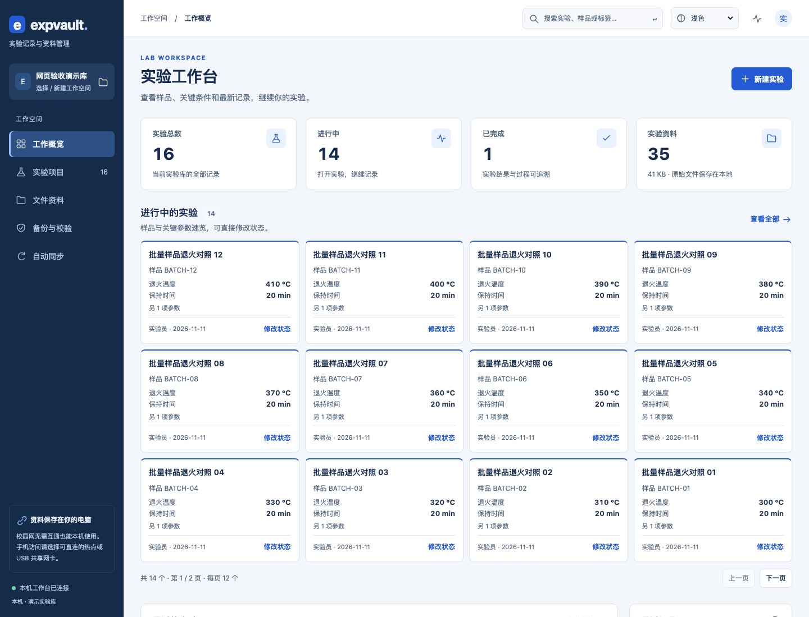
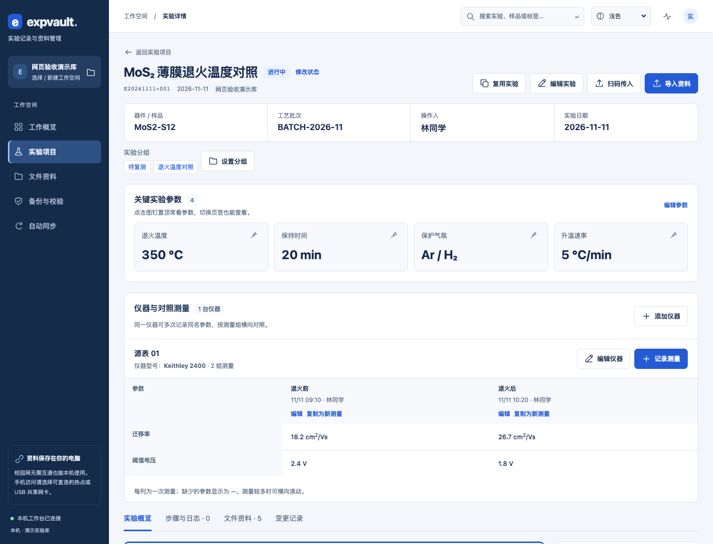
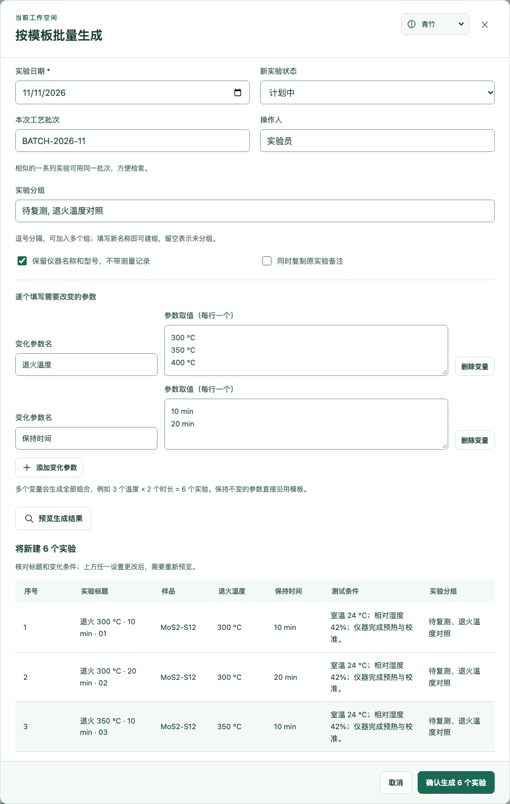
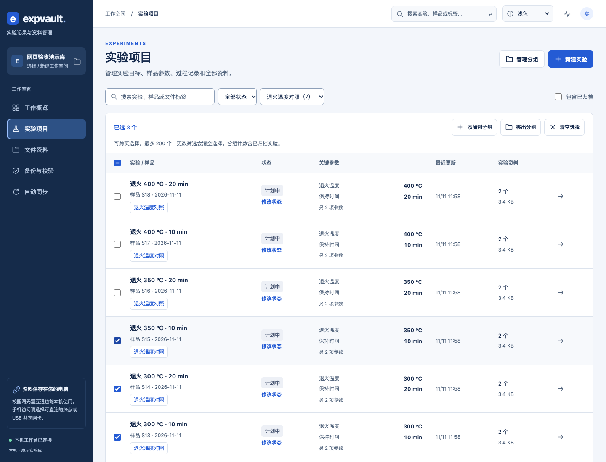
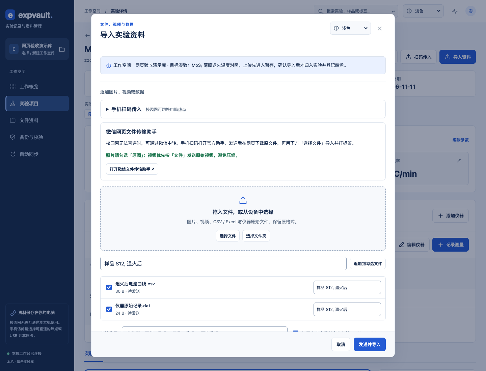
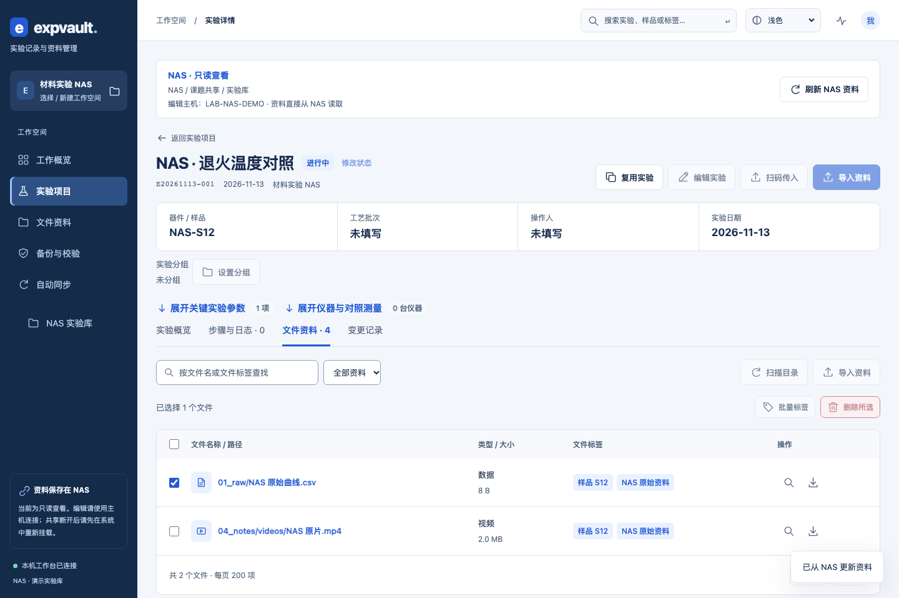
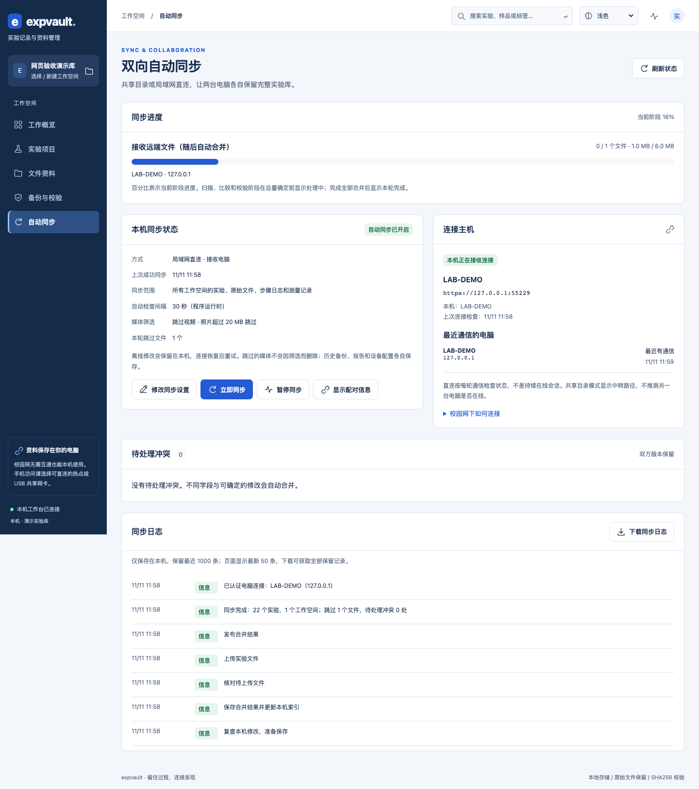
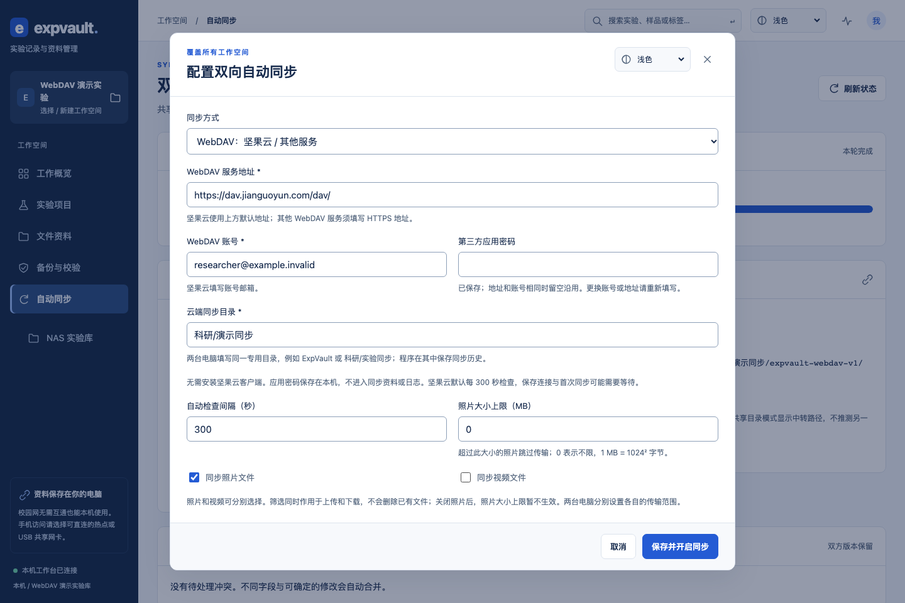

# expvault · 实验记录与资料管理

把一次实验的参数、步骤、照片、视频和仪器数据放在一起，方便查找、对照、备份和换电脑继续工作。

**支持 Mac 和 Windows，主要在浏览器中操作。** 数据保存在自己的电脑；首次装好依赖后，本机日常使用无需外网。

[开始使用](#第一次使用先做这-4-步) · [导入手机和-u-盘资料](#导入手机和-u-盘资料) · [NAS 实验库](#实验库放在-nas其他电脑直接查看) · [两台电脑同步](#两台电脑如何同步) · [数据与备份](#数据存在哪里怎样换电脑) · [常见问题](#遇到问题先看这里)



*截图使用临时演示数据；给其他电脑的独立发布包不含实验记录、个人配置或运行依赖。*

## 第一次使用：先做这 4 步

### 1. 安装 Python

到 [Python 官网](https://www.python.org/downloads/) 选择 **标准 CPython 3.13** 的安装程序，按自己的 Mac / Windows 系统安装。项目支持 Python 3.10–3.13；新安装优先选 3.13，不要直接选择更高版本。

Windows 安装时勾选 **Add Python to PATH**，并保留 Python Launcher。无需安装 Node、Qt 或 Git 来使用独立发布包。

### 2. 解压程序

下载 [expvault-lab-manager-1.9.3.zip](https://github.com/simcrq/expvault-lab-manager/releases/download/v1.9.3/expvault-lab-manager-1.9.3.zip)，然后**完整解压**到可写文件夹，例如桌面或个人文档目录。不要在 ZIP 中直接运行，不要放入 Windows 的 Program Files。

如果拿到的是源码目录，也可以使用，启动文件与独立包有所不同：

| 你拿到的程序 | Mac 双击 | Windows 双击 |
| --- | --- | --- |
| 独立发布包（推荐给日常使用者） | `启动实验管理.command` | `启动实验管理.cmd` |
| 源码目录 | `实验管理网页.command` | `实验管理网页.cmd` |

### 3. 双击启动，等浏览器打开

首次启动会在**目标电脑上**创建独立环境并安装依赖，需要能访问 Python 包源。校园网无法访问时，先配置目标电脑可用的包源或请管理员协助。

独立包随后自动创建程序旁的空 `实验库/`。源码目录若提示未初始化，在源码目录打开终端，运行一次 `python expvault.py init`；Mac 的命令可能是 `python3`，然后重新双击启动。

终端窗口请保持打开。浏览器未自动出现时，复制终端显示的**完整链接**到本机浏览器；链接末尾的配对码也要保留。

### 4. 创建工作空间和第一个实验

1. 点击左侧当前工作空间名称，选择「新建工作空间」，例如“二维材料器件”或“电化学测试”。
2. 点击「新建实验」，填写标题，例如“样品 S12 · 退火温度对照”。
3. 填写样品编号、操作人和关键参数，保存。
4. 打开实验，点击「导入资料」，选择文件或文件夹，添加文件标签，再点击「发送并导入」。

工作空间用来区分完全不同的项目。各空间有自己的实验、文件、配置、备份和报告；切换前确认左侧空间名称，避免把资料放错项目。

**当天结束时先确认任务完成，再备份。** 停止程序请在启动终端按 `Ctrl+C`；只关闭浏览器不会停止服务。

## 一次实验，日常这样记录

| 你想做什么 | 在哪里操作 |
| --- | --- |
| 找到进行中的实验 | 「工作概览」的卡片；每页 12 个，可翻页 |
| 看样品和关键条件 | 实验详情顶部；常看参数可点图钉置顶，参数和仪器对照区均可整块折叠隐藏 |
| 将一系列实验编组 | 「实验项目」勾选后「添加到分组」，或详情「设置分组」 |
| 复制或批量生成相似实验 | 实验详情「复用实验」→「复制实验 / 按模板批量生成」 |
| 修改“进行中 / 已完成” | 实验标题旁、列表或卡片上的「修改状态」 |
| 记操作步骤和现场观察 | 「步骤与日志」，可附图片并引用库里的文件 |
| 比较同一仪器多轮测量 | 「仪器与对照测量」：记录仪器名称、型号和每次参数 |
| 找原片或仪器数据 | 「文件资料」，按文件名 / 标签查找、预览和下载 |
| 改文字格式 | 编辑器的上标、下标按钮；实验备注还支持加粗 |
| 换颜色 | 右上角主题选择，支持浅色、深色、青竹、暖砂、雾紫、深海 |
| 从 NAS 读取共享实验库 | 左侧「NAS 实验库」：一台编辑，其他电脑只读查看 |
| 校验、备份和导出台账 | 「备份与校验」 |



例如材料名可输入 `MoS_{2}`，单位可输入 `cm^{-2}`；备注可用 `**需要复测**` 加粗。界面会显示相应格式，原始文字也会保存。
引用文件时选择库中的来源，不必反复复制同一张照片；仍被步骤或日志引用的资料会受到删除保护。

## 类似实验，不必从头填写

打开一个已有实验，在右上角「复用实验」中选择：

- **复制实验**：创建一个独立副本，可先修改标题、日期、样品、测试条件和参数。
- **按模板批量生成**：组合多个参数取值，或从 Excel 粘贴条件表，每行生成一个实验。先预览，确认后再创建。

例如设置 3 个温度（300 / 350 / 400 °C）和 2 个时长（10 / 20 min），会预览 6 个实验。
标题格式可写为 `退火 {温度} · {时长} · {序号}`，每条记录会独立编号。



默认继承基本信息、分组、目的、条件和参数；新实验为「计划中」，日期为当天。
可保留仪器名称和型号，但不带已有测量值；结果、结论、原始文件、步骤和日志不会复制。
备注默认留空，可单独勾选复制。原实验保留，新记录可查看来源模板。

每次最多生成 100 个，修改条件后需要重新预览。具体表格列名与示例见 [实验模板指南](docs/templates.md)。

## 一系列实验可以编组

在「实验项目」中勾选实验，点击「添加到分组」，例如 `退火温度对照, 待复测`。
一个实验可以加入多个组；新建、编辑、复制和批量生成时也能设置分组。



用列表上方的分组筛选集中查看，也可以选择「未分组」。点击「管理分组」可重命名、合并或解散分组；实验和文件都会保留。
分组随实验备份与双向同步，支持导出台账。每次可批量编组 200 个，具体步骤见 [实验编组指南](docs/groups.md)。

## 导入手机和 U 盘资料

**所有方式都建议先核对目标工作空间与实验，再添加标签。** 标签可按样品、工艺阶段或用途填写，例如“样品 S12”“退火后”“原始曲线”。

| 资料来自哪里 | 怎么做 | 网络要求 |
| --- | --- | --- |
| 本机或 U 盘 | 「导入资料」→「选择文件 / 选择文件夹」，或拖入文件 | 不需要手机与电脑互通 |
| 手机直传 | 「扫码传入」生成二维码，手机扫码选择原图、视频或数据 | 手机与电脑须能直接互通 |
| Windows 热点 | 本机页面一键开启热点，手机先扫码连热点，再扫码上传 | 网卡、系统及校园网策略允许 |
| 微信网页文件传输助手 | 在导入窗口打开官方传输助手，下载资料后回到系统选择导入 | 手机和电脑都能访问微信 |



**微信照片请勾选“原图”，视频优先按“文件”发送原始视频。** 下载后核对大小与内容，避免把截图、缩略图或压缩副本当作原始资料。

选择发送到暂存区时，请先在电脑核对清单和标签，再点击「发送并导入」。手机二维码只接收指定实验的资料；完整网页管理链接的权限更大，请只交给可信设备。

校园网经常隔离终端，连同一个 Wi-Fi 也未必能互传。可使用允许互通的独立热点 / USB 共享网络，或先经 U 盘、微信传输助手把文件复制到电脑。

详细步骤见 [网页管理指南](docs/web.md) 和 [桌面导入指南](docs/gui-import.md)。

## 实验库放在 NAS，其他电脑直接查看

先在 Mac / Windows 系统中挂载 NAS 共享目录，然后在网页左侧选择「NAS 实验库」→「连接 NAS 文件夹」。
一台电脑选择「编辑主机」，其他电脑选择「只读查看」。首次建立新库或转换已关闭的原库时，勾选首次设为 NAS 库。

实验资料保存在 NAS，索引和运行状态放在各电脑本机；查看时直接读取 NAS 文件，不先复制整个实验库。
同一时间只允许一个编辑会话；只读端不能修改或上传。由 NAS 编辑主机生成的上传页可在手机上选择直传当前实验，或先暂存到电脑。连接记录保存在本机，下次可以从列表打开。
NAS 共享库不需要双向同步，断开后也不会自动创建空的本地替代库。



挂载、旧库迁移、断线恢复和终端命令见 [NAS 使用指南](docs/nas.md)。

## 两台电脑如何同步

在两台电脑的本机浏览器中打开「自动同步」。另一台电脑建议先用独立发布包创建空库，再加入同步组；首次同步完成后再开始两端编辑。

| 你的网络情况 | 选择方式 | 设置步骤 |
| --- | --- | --- |
| 两端都能访问坚果云等 WebDAV 服务 | **WebDAV 云端中转** | 填写 HTTPS 服务地址、账号、第三方应用密码和相同的云端目录，无需校园网内互通 |
| 能访问同一个共享盘或同步盘文件夹 | **共享目录中转** | 两端填写各自看到的绝对路径，指向同一份共享内容；中转目录放在实验库之外 |
| 两台电脑可以直接互通 | **局域网加密直连** | 接收电脑从下拉框选择网卡。发送电脑选中在线主机后，两端核对 6 位识别码，在接收电脑确认配对 |

程序运行期间可暂停或恢复自动同步。局域网直连时，发送电脑的新文件可在发送电脑点击「立即同步」，接收电脑会自动合并。接收电脑的「发布本机改动」供本机编辑后使用。



页面会显示连接主机名 / 地址、最近通信、当前阶段、文件数量与传输字节。百分比对应当前阶段，扫描等总量未知的阶段显示处理中，全部合并后才显示本轮完成。下方「下载同步日志」可导出最近 1000 条本机记录。

- **照片、视频独立选择**：分别勾选「同步照片文件」「同步视频文件」，也可设置照片大小上限；`0` 表示照片不限大小。设置同时作用于本机上传和下载，不删除已有文件；两端可分别设置。
- **自动合并与冲突处理**：不同字段的独立修改自动合并；同一处同时改成不同内容时，点击「比较并处理」。文件冲突会保留可见副本，核对后再整理。
- **同步范围**：包含全部工作空间的实验资料（PDF、文档、仪器数据、无扩展名文件等）、分组、标签、步骤日志、引用和测量记录；历史备份、导出报告和设备配置各电脑独立保存。
- **连接状态**：按最近一轮通信更新；共享目录可访问不代表另一台电脑在线。截图中的 `127.0.0.1` 仅用于演示，跨电脑直连请从下拉框选择两台电脑可互通的网卡。



坚果云的地址已预填为 `https://dav.jianguoyun.com/dav/`，账号填写邮箱，密码使用「安全选项 → 第三方应用管理」生成的应用密码。WebDAV 默认每 300 秒检查，限流后显示下次重试时间；大文件受云服务上限约束。应用密码仅保存在本机配置，不返回网页状态或进入同步日志。

校园网不互通时可选择 WebDAV 或共享目录中转。同步会传播修改和普通文件删除，仍需保留自己的备份。配对信息含密钥，请只交给可信电脑。

完整设置、筛选和冲突处理步骤见 [双向自动同步指南](docs/sync.md)。命令行里的 `sync` 是本机目录扫描，与这里的双向自动同步不同。

## 数据存在哪里？怎样换电脑？

独立发布包默认在程序旁保存：

```text
实验库/
├── 数据/           实验记录、照片、视频和仪器文件
├── 工作空间/       新建的其他项目，每个空间有自己的数据与配置
├── 备份/           默认空间的历史备份
├── 报告/           默认空间导出的台账和看板
├── config.json     本机配置
├── 索引/           可重建的本机检索索引
└── .expvault/      工作空间目录记录、同步状态等隐藏文件
```

源码入口使用它打开的实验库根目录，不一定是上述 `实验库/`。可在工作空间列表核对保存位置。

**只想给另一台电脑一套空系统**：复制原始发布 ZIP，勿复制使用过的 `实验库/` 或 `.runtime/`。Python 和依赖由目标电脑自行安装，虚拟环境不能跨 Mac / Windows 复制使用。

**想把全部内容搬到另一台电脑**：先停止两端程序，另行复制完整 `实验库/`，包括隐藏的 `.expvault/` 和 `工作空间/`。换电脑后核对同步方式、网卡地址、路径配置和备份目标，按目标电脑调整。也可使用上文的自动同步，只传实验资料，备份和报告不随它同步。

**想留一份历史备份**：在「备份与校验」选择已配置目标创建备份。普通实验备份分别作用于当前工作空间，不等于备份全部空间目录；请核对备份目标并定期演练恢复。

升级程序时，在新目录解压新版本，先停止旧程序，再迁移已有的完整 `实验库/`；确认工作空间与实验数量后继续使用。

## 遇到问题，先看这里

| 现象 | 先这样检查 |
| --- | --- |
| Windows 提示找不到 Python | 确认安装 3.10–3.13 并勾选 PATH；重新打开启动窗口 |
| Mac 双击提示没有执行权限 | 在程序目录运行 `chmod +x 启动实验管理.command`；源码入口替换成相应 `.command` 文件名 |
| 首次依赖安装失败 | 检查网络和 Python 包源；依赖必须在目标电脑安装，不要拷贝别的系统的环境 |
| 浏览器没打开或链接失效 | 保持启动终端运行，复制这次启动输出的完整链接；重启后不要继续用旧链接 |
| 网页关闭后终端还在 | 这是正常的；在启动终端按 `Ctrl+C` 停止 |
| 看不到预期实验 | 先核对左侧工作空间；同步尚未完成时查看进度和日志 |
| 手机扫码连接不上 | 先检查热点连接与网卡地址；校园网隔离时换中转方式 |
| 同步主机无法连接 | 核对私有 IP、端口、系统防火墙许可与配对信息；查看本机同步日志 |
| 同步进度停住或出现失败 | 检查网络、磁盘空间和页面错误说明；恢复后等待重试或点击「立即同步」 |
| HEIC / TIFF 等原片无法在浏览器预览 | 原始文件仍可保存和下载，用支持该格式的本机应用查看 |
| 担心误改或文件损坏 | 先保留原始资料，再做 SHA256 校验、检查备份；不要直接清空实验库 |

默认只允许本机访问。当前是可信使用者的实验工作台，不提供多人账号与角色隔离，也不用于直接公网托管。

## 更多说明与命令行

日常使用不需要记命令。需要脚本、旧数据整理、备份恢复或源码开发时，继续阅读：

- [网页管理](docs/web.md)：工作空间、状态、仪器对照、文件引用、手机连接。
- [NAS 实验库](docs/nas.md)：挂载目录、主机编辑、只读查看与本机索引。
- [双向自动同步](docs/sync.md)：连接方式、媒体筛选、冲突、进度与日志。
- [桌面导入](docs/gui-import.md)：独立 GUI 插件及环境要求。
- [实验编组](docs/groups.md)：多组归属、批量操作、筛选、重命名与解散。
- [实验复制与批量模板](docs/templates.md)：单次复制、参数组合、Excel / CSV 条件表。
- [命令行与备份恢复](docs/cli.md)：常用命令、目录扫描和恢复示例。
- [构建无数据发布包](docs/release.md)：从已提交版本生成 ZIP，依赖不捆绑。

源码方式的最小启动流程：

```sh
python -m pip install -r requirements.txt
python expvault.py init
python expvault.py web
```

在独立发布包中自行管理环境时：

```sh
python -m pip install -r requirements-release.txt
python lab_manager.py --check
python lab_manager.py
```

Mac 将 `python` 替换为实际安装的 `python3` 即可。`--check` 检查程序完整性与依赖，不创建实验库。

## 开源许可

项目原始代码采用 [MIT 许可证](LICENSE)。第三方组件保持各自许可，见 [第三方说明](THIRD_PARTY_NOTICES.md)；可选 Qt GUI 另受 Qt / PySide 的许可约束。安全使用与报告方式见 [SECURITY.md](SECURITY.md)。
