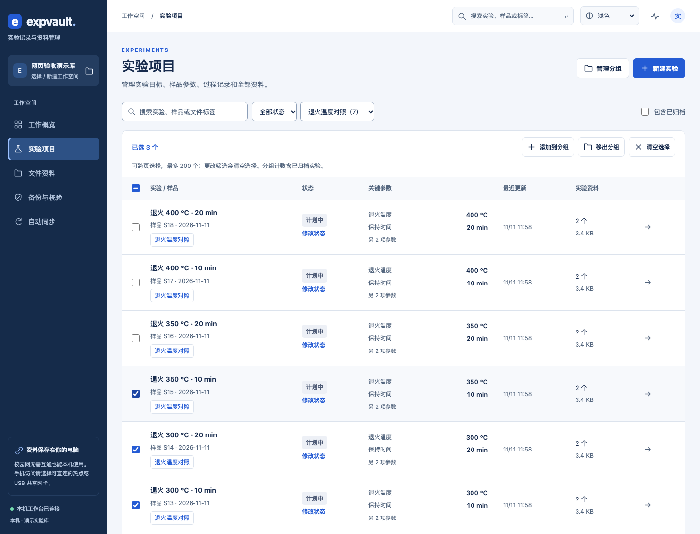

# 实验编组

在同一工作空间内，将同一系列、对照条件或待复测的实验放进分组，方便集中查看。
一个实验可以同时属于多个组，例如「退火温度对照」和「待复测」。编组保留实验原位置，不复制资料。

## 为实验设置分组

- **已有实验**：打开实验详情，点击样品信息下的「设置分组」。也可在「编辑实验」中填写。
- **新实验**：「新建实验」中填写「实验分组」。
- 多个名称用逗号分隔，例如 `退火温度对照, 待复测`。填写新名称并保存后即建立该组。
- 留空表示未分组；每个实验最多 20 个组，每个名称 1–80 字，名称不能包含逗号、换行或控制字符。
- 名称区分大小写，首尾空格会去除；分组名称允许中文与上、下标文字格式。

分组与标签分别保存：分组组织实验，文件标签标注照片和仪器资料。工作空间则是完全独立的实验库。

## 批量加入或移出

1. 进入「实验项目」，勾选实验左侧的复选框。电脑端表头复选框可选择当前页。
2. 点击「添加到分组」，填写已有或新名称，确认后统一加入。原有其他分组保留。
3. 点击「移出分组」可移除填写的组关系，实验和文件仍保留。

支持跨页选择，每次最多 200 个；改变关键词、状态、分组或归档筛选时清空选择。
离开实验列表会清空选择。操作前的窗口会显示选中数量及部分标题，请先核对。

## 筛选与管理

实验列表的「实验分组筛选」可选全部、某个组或「未分组」。点击详情或列表中的组名也能进入该组。
关键词、实验状态和「包含已归档」可以与分组筛选同时使用。

点击列表右上角「管理分组」：

- **重命名**：更新当前工作空间里所有成员；目标名称已存在时合并到该组。
- **解散分组**：确认后只移除组关系，组内实验、文件和其他分组保留。
- 计数包含已归档实验；列表默认隐藏已归档，勾选「包含已归档」后可查看。
- 分组由成员记录生成，移出最后一个成员后，该名称不再显示；重新填写名称即可建立。

## 与模板、同步和导出的关系

复制或按模板批量生成时默认继承来源分组，可在表单里更改或清空。
批量窗口的分组为公共设置；粘贴条件表时可增加 `分组`（或 `实验分组` / `groups`）列，逐行指定不同组。
多个组用逗号分隔；CSV 中该单元格须用双引号包住。空单元格继承公共设置，公共设置留空则生成未分组实验。
标题格式可使用 `{分组}`，多个组名用「、」连接。

分组随实验元数据保存，支持备份、迁移和双向自动同步；不依赖某台电脑的数据库。
新版程序会补齐旧库索引字段，并从原记录读取分组。CSV、Excel 台账、HTML 看板与实验 README 均包含分组信息。

两台电脑分别添加不同分组时会保留双方新增关系；一端移出原有组时，合并会保留该移出操作。
若并发新增使组数超过 20，会保留双方分组；可用「移出分组」整理，整理前不能继续增加。
同一个组同时重命名为两个不同名称时可能保留两个新组，请同步后用「管理分组」整理。
建议参与编组的电脑使用相同版本，旧版网页没有编组操作入口。

整批操作先验证全部选中实验和目标名称，再更新。普通写入错误会尝试恢复本次已改记录。
若断电或进程退出，请先核对实验列表和任务状态，再重试；不要在结果未确认时反复提交。
