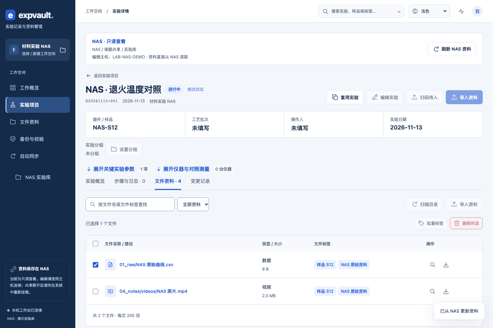

# 把实验库放在 NAS

适合一台电脑负责编辑，其他电脑查看同一份实验资料的使用方式。
程序和依赖安装在各自电脑，实验记录、原图、视频及仪器文件保存在 NAS；查看时直接读取共享文件，不先复制整份实验库到电脑。

## 先在系统中连接共享

- **Mac**：在访达中连接服务器（`⌘K`），输入 NAS 的 SMB 地址并登录。连接后，目录通常位于 `/Volumes/共享名称/`。
- **Windows**：在文件资源管理器中打开 `\\NAS地址\共享名称`，也可映射成 `Z:` 等网络驱动器。
- 使用 NAS 现有的共享账号和权限。建议给编辑主机可读写权限，给查看电脑只读权限。

本程序接受系统已经挂载、能够正常打开的目录，不直接连接 `smb://` 地址，也不保存 NAS 密码。
两台电脑看到的路径可以不同，只要指向 NAS 上同一个实验库文件夹。

## 在网页中选择 NAS 库

1. 在本机启动程序，点击左侧 **「NAS 实验库」→「连接 NAS 文件夹」**。
2. 粘贴挂载路径，例如 Mac 的 `/Volumes/课题共享/实验库` 或 Windows 的 `Z:\实验库`。
3. 选择连接方式：
   - **编辑主机**：可以新建实验、导入、编辑和创建工作空间；同一时间只能有一个编辑会话。
   - **只读查看**：可以查看实验、步骤、仪器对照、预览或下载文件、导出本机报告；不能修改实验或上传。
4. 第一次建立 NAS 库时，选择编辑主机，并勾选「首次建立或将已关闭的原库设为 NAS 实验库」。以后连接不要再勾选。
5. 点击「连接并打开」。页首会显示 NAS 位置与当前连接方式。



连接会保存在**当前电脑**的 NAS 列表，下次可直接点击「只读打开」或「作为编辑主机打开」。
主机和查看端都能使用 NAS 内的工作空间；各电脑的工作空间选择独立保存。
点击「刷新 NAS 资料」重新读取共享记录。目录扫描有短暂缓存，普通页面切换最多延迟约 2 秒；主动刷新会立即重新扫描。

只读按钮会停用；即使绕过页面直接发请求，后台也会拒绝修改、文件上传和手机接收会话。
文件下载、视频分段读取直接来自 NAS。普通浏览不会为了建立索引而通读全部视频或大照片。

## 把已有实验库迁到 NAS

1. 停止原电脑上使用这个库的所有程序与同步任务。
2. 用系统文件管理器复制 `config.json`、`数据/`、`工作空间/` 和工作空间目录记录（隐藏的 `.expvault/workspaces.json`）到 NAS。保留各工作空间内的归属记录 `.expvault/workspace.json`；原库先留作备份。原设备的同步凭据、网页会话和暂存资料不需要搬到共享目录。
3. 在编辑主机连接这份 NAS 目录，选择编辑主机并勾选首次设为 NAS 库。
4. 核对实验数量和文件，再让其他电脑以只读方式连接。

转换只更新存储设置，不移动或清空实验文件，不打开 NAS 上旧的 SQLite 索引。新版本从实验目录恢复各电脑的本机索引。
相对目录设置会继续沿用，Windows 的目录分隔符会转换为跨平台形式；如果 `paths` 中手填了某台电脑的绝对路径，需要先改为库内相对路径。
有未完成的旧同步事务时，先在原电脑恢复完成，再转换。

**参与访问的客户端都应使用 1.6.0 或更新版本。** 不要继续用旧版程序直接打开已转换的 NAS 共享库。
NAS 共享库不再运行双向自动同步：各终端本来就在读同一份文件，不需要另建副本互相合并。

## 哪些内容放在哪里

| 内容 | 保存位置 |
| --- | --- |
| 实验元数据、原始资料、日志正文、步骤与测量 | NAS 实验目录 |
| 工作空间目录记录、编辑占用、共享文件校验摘要 | NAS 的 `.expvault/` |
| SQLite 检索索引、网页任务、临时上传、终端当前实验与运行日志 | 各电脑本机 |
| 导出的台账和报告 | 各电脑本机 |
| NAS 连接路径和显示名称 | 各电脑本机 |
| 历史备份 | 编辑主机配置的备份目标；默认「NAS 快照」仍在同一 NAS |

本机状态默认位于：

- Mac：`~/Library/Application Support/expvault/nas/`
- Windows：`%LOCALAPPDATA%\expvault\nas\`

本机索引是缓存，可重建；共享配置里不保存这些本机绝对路径。
SQLite 的 WAL 模式不支持网络文件系统，因此索引固定放在本机，不把同一个 SQLite 文件交给多台电脑打开。
原理见 [SQLite 官方说明](https://www.sqlite.org/wal.html)。不要把本机状态目录另外重定向到网络盘。

## 校验和扫描

新导入文件的 SHA256 会保存为共享校验摘要，其他电脑读取摘要即可使用校验基线。
从旧库迁来的已有文件，如果还没有共享摘要，会显示「尚无校验基线」，不会误报为已经健康或内容损坏。
在**编辑主机**打开来源实验的「文件资料」，点击「扫描目录」，建立当前文件的基线；这一步会实际读取尚未计算摘要的文件，大视频可能耗时较长。
之后使用「校验文件」比较内容。基线只代表建立时的状态，不能反推迁移前文件是否已经变化。

## 占用、断线与退出

编辑主机退出程序后会释放占用。只关闭浏览器不会停止程序；请在启动终端按 `Ctrl+C` 并等待后台任务结束。
编辑主机占用期间，其他电脑可以只读查看，不能自动抢占编辑权。

NAS 断开、目录丢失或库标识变化时，会提示重新连接，不会在原路径悄悄创建空的本地替代库。
重新挂载后再刷新或打开连接。断线发生在写入中时，请先核对任务结果与实际文件，再重试。

异常退出可能留下占用记录。程序不会因超时自动抢占，以免仍运行的主机与新主机同时写入。
**确认原编辑主机已完全停止**后，可在另一电脑解除遗留占用：

```sh
python expvault.py nas unlock "/Volumes/课题共享/实验库" --confirm-stopped
```

不要在原编辑程序仍运行时解除占用，也不要直接删占用目录。
NAS 快照与原数据同盘，仍需按自己的要求配置其他设备上的独立备份。
本次自动测试使用临时目录模拟挂载和断线，不替代具体 NAS、SMB 服务及操作系统组合的实际验证。

## 从终端直接启动

源码入口（Mac 将 `python` 换为自己的 `python3`）：

```sh
# 首次建立共享库并作为编辑主机打开
python expvault.py nas connect "/Volumes/课题共享/实验库" --mode writer --init --name "材料实验 NAS"

# 其他电脑只读打开
python expvault.py nas connect "/Volumes/课题共享/实验库" --mode viewer

# 列出当前电脑保存的连接；按显示的连接编号重新打开
python expvault.py nas list
python expvault.py nas open <连接编号>

# 查询默认只读；明确需要写入时才申请编辑占用
python expvault.py --root "/Volumes/课题共享/实验库" list
python expvault.py --root "/Volumes/课题共享/实验库" show E20261113-001
python expvault.py --root "/Volumes/课题共享/实验库" --nas-write new "退火对照"
```

Windows 可将上述路径换成 `Z:\实验库`，或当前系统能打开的 UNC 共享目录。
只读终端支持查询、文件打开、导出和校验；需要记录操作过程时，通过编辑主机的网页或带 `--nas-write` 的写命令完成。

独立发布包也可直接启动指定 NAS，不必先创建本机实验库：

```sh
python lab_manager.py --nas "/Volumes/课题共享/实验库" --nas-mode viewer
python lab_manager.py --nas "/Volumes/课题共享/实验库" --nas-mode writer --init-nas
```

`--init-nas` 只用于首次建立或转换，并且要求编辑主机模式；普通打开不要添加。
