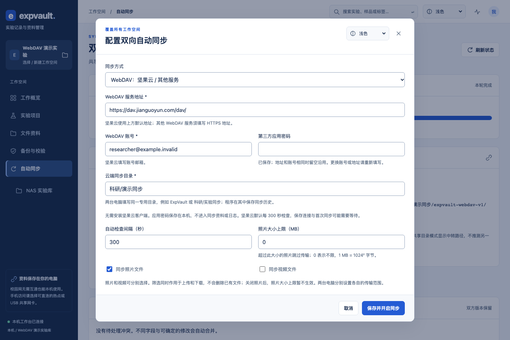

# 两台电脑双向自动同步

在本机浏览器的左侧导航打开「自动同步」，点击「配置同步」。程序运行时定期检查另一端，
两台电脑均可新增和编辑实验；关闭程序后停止检查，下次启动会继续。共享目录和直连默认每 30 秒检查一次，可设置为 5–3600 秒；WebDAV 默认 300 秒，最少 60 秒。

建议另一台电脑从无数据发布包启动空库后加入同一同步组。首次传输可能较久，开始两端编辑前，先在两端的「实验项目」中确认已收到需要的实验。
同步作用于本进程登记的**全部工作空间**，从哪个工作空间打开设置都一样。

## 选择连接方式

### WebDAV：坚果云（推荐用于跨网络）

两台电脑只需都能访问坚果云，无需在校园网内互通，也不需要安装坚果云同步客户端。
每台电脑各自保存一份完整或经过媒体筛选的实验库，云端专用目录交换版本；请两端都使用 **1.7.0 或更新版本**。

1. 登录坚果云，在「账户信息 → 安全选项 → 第三方应用管理」中添加应用并生成**应用密码**，不要使用登录密码。
2. 打开本系统「自动同步 → 配置同步」，选择「WebDAV：坚果云 / 其他服务」。
3. 填写以下内容，在第二台电脑填写同一云端目录：

   | 设置 | 坚果云填写内容 |
   | --- | --- |
   | WebDAV 服务地址 | `https://dav.jianguoyun.com/dav/`（已预填） |
   | WebDAV 账号 | 坚果云账号邮箱 |
   | 第三方应用密码 | 上一步生成的应用密码 |
   | 云端同步目录 | 专用相对目录，例如 `ExpVault` 或 `科研/实验同步` |
   | 自动检查间隔 | 建议保留 300 秒或更长 |

4. 按需要分别勾选「同步照片文件」「同步视频文件」，可继续设置照片大小上限。
5. 点击「保存并开启同步」。保存会验证连接和读写设置，首次建立目录可能需要等待几十秒；成功后查看连接、进度条和日志。
6. 另一台电脑从空库加入，等待两端显示成功时间。之后支持双向编辑、自动合并及冲突比较。

程序仅操作所选目录下的 `expvault-webdav-v1/`，不会整理账号中的其他文件。
这是系统专用同步存储，不是将网盘任意文件夹直接导入实验；已有实验须先通过本系统登记。
其他 WebDAV 服务填写其实际 HTTPS 地址、账号和应用密码，并须支持 PROPFIND、MKCOL、GET、HEAD、PUT、MOVE 和条件写入。
程序验证 HTTPS 证书，不跟随重定向；地址提示跳转时填写最终服务地址，不关闭证书验证。

坚果云的请求与单文件限制见 [官方授权说明](https://help.jianguoyun.com/?p=2064) 和 [官方连接示例](https://help.jianguoyun.com/?p=5677)。当前官方说明默认单文件上限为 500 MB，免费账号每 30 分钟 600 次、付费账号 1500 次请求。
本系统访问坚果云时将请求间隔控制为至少 3.1 秒，缓存本次运行已经确认的不可变对象；首次大量文件同步会较慢。
多台电脑和其他软件共用账号时，请求额度也会共用，可延长自动检查间隔并关闭大媒体。
收到 429 / 503 时遵守服务端等待时间；未提供等待时间时默认等待 30 分钟。页面显示下次重试时间，「立即同步」不会绕过限流等待。
网络错误、空间不足、超出单文件上限或校验失败时保留本机数据并提示，不会把失败当成删除。

应用密码保存在**本机实验库**的 `.expvault/sync/settings.json` 中，不加密；在支持的系统权限范围内限制为当前用户读写。
密码不会返回网页状态，也不会进入实验同步、同步日志、报告或发布包；修改设置时密码框留空仅沿用相同地址、相同账号的已存密码。
请保护本机账号，勿分享整个运行目录或同步配置。设备编号另存在本机用户状态目录，即使把实验库拷贝到另一台电脑，也会独立发布同步进度。
中转历史包含原始实验内容，不提供额外的端到端加密；坚果云应用密码可以在其账号设置中撤销。

云端仅列出少量设备进度，再按摘要追踪历史，因此不需要列出包含大量文件的整个历史或对象目录。
不要手动修改、删除或重命名 `expvault-webdav-v1/`；传输中断可能留下 `.part` 暂存文件，程序不会把它们作为完整对象使用。
此目录与「共享目录中转」的 `expvault-sync-v1/` 格式不同，两种方式不能混用同一个同步组。

### 共享目录中转

适合校园网隔离两台设备、但两端都能访问同一共享盘，或使用已有同步盘客户端的场景。

1. 选一个专用的共享文件夹，放在实验库之外。两端必须能读写同一份内容。
2. 两台电脑分别选择「共享目录中转」，填写各自电脑看到的绝对路径，例如 Mac 的 `/Volumes/课题共享/实验同步`，或 Windows 的 `Z:\实验同步`。
3. 保存并开启同步。程序在此文件夹中创建 `expvault-sync-v1/`，不覆盖其他文件。
4. 等待两端显示成功时间；同步盘客户端也需要保持运行，并将这个目录完整保存在本地。

路径可不同，但指向的必须是同一份共享内容。不要手动修改、删除或重命名其中的对象和历史提交。
共享盘掉线、历史尚未传完或目录被换成另一个同步组时，页面会提示并重试，保留本机数据。
不要同时用第三方同步盘直接同步整个正在运行的实验库、SQLite 数据库或 `.expvault/`；只让它搬运专用中转目录。

### 局域网加密直连

适合两台电脑能直接访问彼此的局域网、独立热点或其他私有网络。无需让完整网页管理界面对外开放。

1. 在常开电脑上选择「局域网直连：本机接收连接」，从下拉框选择两台电脑可互通的 Wi-Fi、有线或热点网卡。默认同步端口是 `8766`。
2. 接收电脑保存并开启同步，留在「自动同步」页面。发送电脑选择「局域网直连：连接另一电脑」，从「在线同步主机」选中接收电脑，发起配对请求。
3. 接收电脑在「待确认的配对」中查看发送电脑的名称、IP 地址和 6 位识别码。与发送电脑屏幕上的识别码一致时点击「确认配对」；不一致时点击「拒绝」。请求有效期为 2 分钟。
4. 发送电脑看到确认结果后，点击「保存并开启同步」。两端都保持程序运行，连接成功后编辑会双向传递。

发送电脑新导入文件后，在发送电脑点击「立即同步」。接收电脑收到完整的变更记录就会自动合并，文件写入实验目录并更新索引后可在「文件资料」核对。
接收电脑的「发布本机改动」供本机编辑后使用。「本机处理完成」表示这一轮本机处理结束，收到哪些文件可在实验的「文件资料」查看。

「仅本机 · 127.0.0.1」用于同一电脑内测试。网卡地址改变后，在接收电脑重新选择网卡，再给另一端重新配对。
自动搜索使用同网段 UDP 广播（端口 `37666`）。确认配对需要两台电脑都使用 v1.9.1 或更新版本。旧版或广播受限时，从接收电脑查看手动配对信息，再将完整内容粘贴到发送电脑的「手动配对」设置。
系统询问时允许 Python 访问专用网络；程序沿用系统和网络的访问设置。
校园网可能隔离设备，即使连同一 Wi-Fi 也不能保证可直连；无法访问时选共享目录中转，或使用允许互通的独立网络。

直连使用 HTTPS、独立同步密钥和证书指纹校验；证书不匹配时不发送密钥和数据。
配对信息含访问整个同步库的密钥，只交给可信电脑，不放到公开聊天、截图或报告中。
暂停接收电脑的同步会关闭直连监听；暂停期间不提供配对信息。这些连接方式都只用于可信设备，不提供多人权限隔离。

## 可选不同步照片、视频和过大照片

在「修改同步设置」中：

- 取消「同步照片文件」：跳过所有支持识别的照片格式，与视频开关相互独立。
- 取消「同步视频文件」：跳过 MP4、MOV 等常见视频格式。
- 「照片大小上限（MB）」：超过该值的照片跳过，支持 JPG、PNG、HEIC、TIFF 及常见 RAW 格式。`0` 表示不限；例如填 `20`，超过 20 MB 的照片不传。1 MB 按 1024² 字节计算。

设置作用于**本机上传和下载两个方向**。两台电脑各自设置；希望两端都跳过这些媒体时，两端都配置。
筛选不会删除已保存的文件，也不会把“没传这个文件”当成删除操作。实验文字、标签和引用继续同步；
引用到本机未下载的文件时，会显示文件缺失，重新允许该媒体并完成同步后可查看。

重新勾选照片、视频或提高 / 清除照片上限后，会补传允许的文件。关闭照片时大小上限暂不生效。另一端在此期间更新了文件时，
不会把本机未更新的旧媒体直接写回；若两边都改过同一文件，会保留冲突副本供核对。
页面的跳过数量是本轮扫描本机文件的数量，不是远端待下载文件总数。
格式按文件扩展名识别，改名不能替代正确设置；筛选不清理此前已传入中转目录或本机缓存的历史内容。

## 查看连接、进度与日志

「自动同步」页面新增三块信息：

- **连接主机**：直连客户端显示已核对的远端主机名、HTTPS 地址和最近连接检查时间；接收电脑显示本机接收地址，以及最近通过认证的电脑名、IP 和通信时间。主机名由对端提供，仅用于辨认设备。旧版对端不提供主机名时显示地址。
- **同步进度**：显示当前阶段、文件数量、当前文件与已传输 / 待传输字节。上传、下载和直连接收按实际数据块更新百分比；扫描、比较和总量未知的阶段显示处理中。百分比对应当前阶段，完成合并并发布后显示「本轮完成」，直连接收电脑显示「本机处理完成」。已经传入接收电脑、还未完成合并的文件会显示等待合并。
- **同步日志**：记录设置、暂停 / 恢复、阶段、传输完成的文件、同步结果、跳过数量、冲突数量和失败原因。页面自动刷新，显示最新 50 条；「下载同步日志」导出本机保留的最近 1000 条为 UTF-8 文本，可在 Windows / Mac 查看。重启后保留历史记录。

连接状态按最近一轮通信更新，不是持续在线检测；共享目录模式显示中转路径和可访问状态，不能据此判断另一台电脑在线。
失败或暂停不会显示同步完成。网页只在自动同步页面每秒检查状态，其他页面约每 3 秒检查；很短的阶段可能已经完成而没有停留展示。
日志存放于原库 `.expvault/sync/activity.json`，不参与实验同步，不记录配对密钥；日志可能含主机名、IP、文件名和目录，分享前可先核对内容。
仅本机已授权网页可以查看或下载日志。日志保存失败会在页面提示，避免阻止实验数据的同步与恢复。

## 同步范围

同步实验元数据及实验目录中的各类资料，包括 PDF、办公文档、压缩包、仪器专用格式和无扩展名文件。
照片和视频可按上文筛选。同步还包含文件标签、步骤与过程图片、现场日志和文件引用、
仪器型号与多轮测量参数、实验变更记录、README 手写区、工作空间名称 / 默认课题 / 实验目录结构，以及问题记录。

各电脑独立保存历史备份、导出报告、索引、上传暂存、默认操作人、备份目标、路径配置、
浏览器主题 / 参数置顶偏好和同步密钥。SQLite 索引在各电脑重新生成，不传数据库文件。
实验目录中自行保存的分析结果属于实验资料，会同步；「报告」目录中由导出功能生成的报告不传。
备份设置和备份行为不受媒体同步筛选影响。

## 自动合并和冲突处理

不同实验、不同参数键或不同字段的独立修改会自动合并；新增步骤、日志、仪器分组和测量有稳定编号，
可保留两端新增的记录。文本不同位置的可确定修改也会合并。
两端分别新建了编号相同的实验时，保留两个实验，其中一个编号添加同步后缀，并调整引用。

同一字段同时改成不同内容时，「自动同步」显示待处理冲突。点击「比较并处理」，
选择使用哪个版本。处理结果会同步到另一端。也可先在实验中整理出想保留的最终内容，再选「保留当前最新内容」。
旧冲突已经发生后续修改时，不能用旧版本直接覆盖最新内容。

同一二进制文件发生冲突时，两端版本及可用的原始基线会作为带「同步冲突」名称和标签的文件保留，
可以在「文件资料」预览或下载核对。确认冲突后，副本仍保留，用户核对后可按普通文件删除。
普通文件删除会传播；若另一端同时修改该文件、或新增了对它的引用，则保留文件并提示冲突。
整个实验或工作空间的删除须比较处理，不自动静默删除整组记录；日常整理建议使用「归档」。

## 中断、存储和边界

同步检查 SHA256，传输先写临时文件，完整校验后才采用。网络传输不长期占用实验写锁；
应用修改前会再检查本机是否更新，写入失败会回滚。若断电或进程退出，下次启动先恢复未完成事务再接受新的网页写入。
页面显示错误时可保留两端原始资料，恢复网络 / 磁盘空间后点「立即同步」，或等待自动重试。
「暂停同步」会保存暂停状态；「恢复自动同步」继续。程序关闭后不作为后台系统服务运行。

中转目录和本机同步缓存保留不可变历史，目前不自动清理旧版本，需预留磁盘空间。
**同步不能替代备份**：误改和普通文件删除也可能传播，应继续使用各电脑自己的备份。
共享目录包含实验原始内容，应使用受信任的共享存储并限制文件夹访问权限；不要放入公开目录。

实验数据目录须在各工作空间内部，不能直接等于空间根目录。符号链接、Mac / Windows 不兼容的文件名、
大小写或 Unicode 归一化重名会暂停同步并提示，先整理为实际文件和唯一名称。
同步期间通过本网页修改数据；外部脚本或编辑器直接写文件时应先暂停，完成后再恢复。
切换到另一个同步组会保留本机实验，将其作为新组的数据参与合并，不会清空原库。

### 实验分组

分组关系保存在实验元数据中，参与同步。两端分别添加组会合并保留，一端移出原有组会保留该移出。
同时将同一个组改成两个新名称时可能保留两个名称，需同步后在「管理分组」整理。建议两端使用相同版本。
详见 [实验编组](groups.md)。

### 与直接打开 NAS 共享库的区别

共享目录中转模式仍是各电脑各自保存一份实验库，再通过中转目录交换版本。
若希望多台电脑直接读取 NAS 上同一份资料，请使用 [NAS 实验库](nas.md)：一台编辑、其他只读，索引留在本机。
直接打开的 NAS 共享库不启用双向同步。
