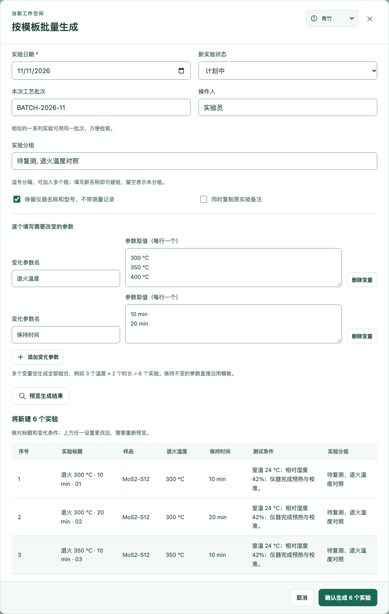

# 复制实验与按模板批量生成

适合“样品处理方式相近，只改变温度、时长、气氛等条件”的一系列实验。
任意已有实验都能作为模板，不必另建模板文件；已完成或已归档的实验也可复用。

## 先了解复制范围

每个新实验都有新的实验编号、同步编号、创建时间与变更记录，并保存在当前工作空间。
默认日期为当天，状态为「计划中」，可改为「进行中」。源实验始终保留。

| 内容 | 处理方式 |
| --- | --- |
| 课题、操作人、样品、批次、类别、标签、实验分组 | 继承，可在复制表单或条件表中修改部分字段 |
| 实验目的、测试条件、工艺 / 测试参数 | 继承；新值仅作用于新实验 |
| 仪器名称和型号 | 默认保留，可取消勾选；新仪器记录使用独立编号 |
| 已有测量值、结果、结论 | 不复制，留给新实验实际测量和填写 |
| 原始图片 / 视频 / 数据、文件标签、步骤、现场日志及引用 | 不复制 |
| 实验备注 | 默认留空，勾选「同时复制原实验备注」才继承 |

需要复用某份原始资料时，新实验生成后可在步骤 / 日志中引用库中的来源文件。
新记录顶部显示来源模板；元数据还保存来源同步编号、源版本与本次生成批次编号。

## 复制一个实验

1. 打开来源实验详情，点击右上角「复用实验」→「复制实验」。
2. 填写新标题、日期、样品、批次、操作人、条件与参数。
3. 核对仪器和备注选项，点击「创建副本」。
4. 页面进入新实验，可开始记录本次测量和文件。

复制窗口中的参数表是新实验的完整参数表，可增加、修改或删除行；原实验参数不变。

## 按参数取值生成全部组合

1. 来源实验详情 →「复用实验」→「按模板批量生成」。
2. 选择「组合参数取值」。给每个变化参数填写名称，每行填写一个取值。
3. 用「添加变化参数」增加变量；最多同时设置 4 个。
4. 填写日期、批次、操作人和标题格式，再点击「预览生成结果」。
5. 核对数量和每行条件，点击「确认生成 N 个实验」。

例如：

| 参数 | 取值 |
| --- | --- |
| 温度 | `300 °C`、`350 °C`、`400 °C`，各占一行 |
| 时长 | `10 min`、`20 min`，各占一行 |

这会生成 3 × 2 = 6 个实验；未变化的参数沿用来源实验。



标题格式支持 `{模板标题}`、`{序号}`、`{样品}`、`{分组}` 以及参数名，例如：

```text
退火 {温度} · {时长} · {序号}
```

序号从 `01` 开始。标题必须为 1–256 字，未知变量会提示修改；科学文字中的 `MoS_{2}` 等格式可正常保留。
不要把重复的参数名填成多个变量；需要同一条件的平行实验时，可以在条件表中填写多行。

## 从 Excel 粘贴，每行生成一个实验

选择「每行一个实验（粘贴表格）」。从 Excel 复制带首行列名的区域，粘贴到「条件表格」；
也可以填写标准 CSV。每行是一个实验，不再计算所有组合。

```csv
标题,样品,温度,时长,条件
退火组 A,S01,300 °C,10 min,Ar 气氛
退火组 B,S02,350 °C,20 min,N2 气氛
"平行样品,一",S03,350 °C,20 min,"Ar, H2 混合气氛"
```

- 列名可用：`标题`、`样品`、`条件`、`批次`、`操作人`、`课题`、`类别`、`目的`、`备注`、`日期`、`状态`、`分组`（或 `实验分组`）。
- 其他列名作为参数名，例如 `温度`、`时长`。若参数名与上述字段同名，用 `参数:条件` 这样的列名明确指定参数。
- 空单元格沿用模板或窗口上方的公共设置；空标题使用标题格式生成。分组可在公共设置中修改；条件表逐行填写分组可覆盖公共设置，多个名称用逗号分隔。
- 日期填写 `YYYY-MM-DD`；状态填写「计划中 / 进行中」或 `planned / running`。
- 含逗号、换行的 CSV 单元格用双引号包住，单元格内双引号写成两个双引号。

点击「预览生成结果」，核对每行的标题、样品、变化参数、测试条件与实验分组，再确认生成。
同一行可只改一个参数，其他参数保持模板中的值。生成结果列表可逐项「打开实验」。
提交后会固定本次已预览的设置；关闭生成窗口后，仍可从任务面板「查看结果」。

## 数量、并发与中断

每次最多生成 100 个；超过上限需减少取值或分批。输入格式错误或无效日期会在写入前拒绝整个请求。
上方条件有任何修改时，确认按钮会停用，必须重新预览；切换颜色主题不会清空预览或表单。

提交时会核对来源模板的版本。其他窗口已经修改模板时，本次不会继续创建，请刷新核对再打开模板窗口。
同一个操作请求不会重复创建；生成中的普通写入失败会尝试清理本次新建记录，原实验不受影响。
如果断电、进程退出或连接中断，先检查实际实验列表与任务状态，避免未核对结果就再次生成。

复制和批量生成的实验参与原有备份、导出和双向自动同步；历史文件与结果不会因模板复用混入新实验。

分组默认沿用来源，可在复制或批量窗口清空后生成未分组实验。详见 [实验编组](groups.md)。
